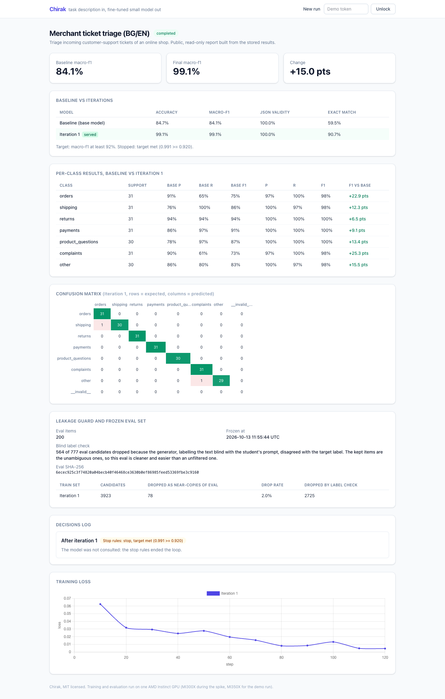
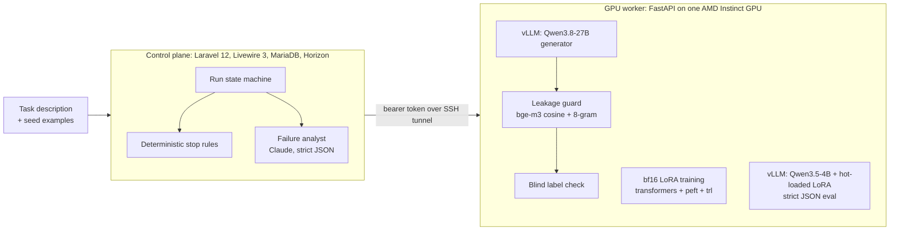

# Chirak

*Чирак* — apprentice. A master model teaches a small apprentice model one craft until it can do it alone.

Chirak turns a task description and a handful of examples into a small, self-hosted specialist model.
It freezes an eval set first, measures the untouched base model, synthesizes training data, LoRA
fine-tunes a 4B model on one AMD Instinct GPU, lets Claude analyse the failures, regenerates data for
the weak classes and stops on deterministic rules. Built for the AMD Developer Hackathon ACT III,
track *Reinvent Commerce*. Demo task: support-ticket triage for an online shop, Bulgarian and English.



**Live demo: https://chirak.fleetq.net** — stored run reports and a playground that answers on CPU
(read-only: no GPU there, so no new runs; the playground needs the demo token).

Demo video (2 min): [docs/chirak-demo.mp4](docs/chirak-demo.mp4). Recorded on 14 Oct 2026 by a
Playwright script ([demo/video/](demo/video/)) with a synthetic voice (macOS `say`) and captions. The
playground answers in it are live calls to the iteration-2 adapter on an MI350X. It shows run 4,
before guidelines v2 and the real-text work below.

## Where it stands (14 Oct 2026)

The best model is run 6 (`merchant-triage-orv1o6`): clearer labelling guidelines (v2) plus 378 real,
human-written support chats in the training data next to the synthetic ones. Scored on text written by
people, which the earlier runs were not tuned against:

| All three fields right (category, urgency, needs_human) | Real tweets to retailers, 356 | A shop's own tickets, 146 |
|---|---|---|
| Qwen3.5-4B, no fine-tune, first guidelines | 0.29 | – |
| Run 4 iteration 2 (synthetic data only, first guidelines) | 0.43 | – |
| Qwen3.5-4B, no fine-tune, guidelines v2 | 0.35 | 0.33 |
| **Run 6 iteration 2 (guidelines v2 + real chats)** | **0.59** | **0.55** |

- *Real tweets*: first customer tweets to Amazon, Target, M&S, eBay and Argos (2017, CC BY-NC-SA),
  labelled by a Claude judge under guidelines v2. *Own tickets*: another 146 such tweets, never used
  anywhere else, run through the new "bring your own tickets" flow (mask personal data, Claude labels
  twice, review, freeze, score); its 18 review decisions were made by Claude Code on the owner's
  delegation, not by a person. Both sets favour v2 models somewhat, since their labels follow v2.
- On ABCD store chats, whose labels do not depend on the guidelines, category accuracy is 0.74 (base)
  → 0.80 (run 4) → 0.84 (run 6; but run 6 trained on other ABCD chats).
- Clearer guidelines alone lifted the base model from 0.84 to 0.935 macro-F1 on clean synthetic
  tickets; a run that only targets category stops there with "not worth fine-tuning". The gains
  from fine-tuning are now in urgency and needs_human.
- The playground serves run 6 as a GGUF q8_0 build on CPU (llama.cpp); on the same files it scores
  within a few tickets of the bf16 model the GPU evaluated.

Full tables, caveats and every file hash: [docs/demo-run-log.md](docs/demo-run-log.md). What changed
and why: [docs/requirements-improvements.md](docs/requirements-improvements.md).

## Result of the first demo run (run 4)

Run `merchant-triage-g4oirl`, 13 Oct 2026, one AMD Instinct MI350X. Every number below is in the
`evaluations` table and reproducible with `make eval ADAPTER=<path> EVAL=<eval|eval-hard>` (see
[docs/demo-run-log.md](docs/demo-run-log.md)). Public report: **https://escapeboy.github.io/chirak/**

The run is measured on two frozen eval slices, reported separately:

- **Clean slice** (`eval`, 215 tickets, sha256 `6ecec925…3c9160`): tickets where the 27B generator's
  label and its own blind re-reading agree. These are the clear cases; easier than real traffic.
- **Hard slice** (`eval-hard`, 119 tickets, sha256 `c5997a47…80a0f1`): tickets the blind check
  rejected, re-labelled by a Claude judge (two passes) and reviewed. The 106 disagreements were
  reviewed by Claude Code on the owner's delegation, not by a human.

| macro-F1 (category) | Clean slice | Hard slice |
|---|---|---|
| Qwen3.5-4B, no fine-tune | 0.841 | 0.772 |
| + Chirak LoRA, iteration 1 | 0.991 | 0.825 |
| **+ Chirak LoRA, iteration 2 (served)** | **0.982** | **0.844** |
| + Chirak LoRA, iteration 3 | 0.981 | 0.833 |

| Hard slice, base → iteration 2 | category acc | urgency acc | needs_human acc | all 3 fields right | valid JSON |
|---|---|---|---|---|---|
| | 0.82 → 0.87 | 0.78 → 0.84 | 0.82 → 0.92 | 0.59 → 0.66 | 100% → 100% |

The target was macro-F1 ≥ 0.92 on the hard slice. **It was not met**: the loop ran the maximum of 3
iterations and serves iteration 2. The weak class is *complaints* (F1 0.67), mostly confused with
*returns* and *other*. Iterations 2–3 were steered by Claude's analysis of hard-slice failures; its
guidance sometimes describes those failures closely, and the train data moved slightly closer to
eval-hard (no train ticket reaches cosine 0.90). Read the +1.9 pt of iteration 2 with that in mind.

### On text written by people

The clean and hard slices are both synthetic. Two public datasets with human-written text were added
afterwards and frozen before scoring ([details](docs/demo-run-log.md#real-text-checks-2026-10-14)):

| Category, base → iteration 2 | n | accuracy | macro-F1 |
|---|---|---|---|
| ABCD chats with an online store, labels from the writer's scenario (MIT) | 300 | 0.74 → 0.80 | 0.74 → 0.81 |
| Real tweets to Amazon, Target, M&S, eBay, Argos (2017), labels from a Claude judge | 357 | 0.72 → 0.75 | 0.69 → 0.71 |

The adapter still helps on real text, but far less than the synthetic slices suggest, and on real
tweets both models sit around 0.7. On tweets needs_human got worse (0.84 → 0.73). Most errors are
shipping vs orders vs complaints, which the task's guidelines leave open. English only: no public
Bulgarian support-ticket data was found.

5 hold-out tickets that are in no dataset file (written by Claude at the owner's request, not by a
human), all three fields right: base 2/5, iteration 2 5/5 — a spot check, not a metric. Two earlier
demo runs were discarded at the human checkpoint before any training; the log says why.

## How it works



1. **Eval first.** The generator writes the eval set (temperature 0.7, seeds as style examples); it
   is frozen with a sha256 and never changes for the run.
2. **Baseline.** The untouched 4B student is scored on it. If it already meets the target, the run
   ends with "not worth fine-tuning".
3. **Train data.** A different prompt at temperature 1.0 that has no parameter for seeds or eval
   items. Every candidate goes through the leakage guard (cosine ≥ 0.92 with bge-m3, or a shared
   word 8-gram, against eval) and the blind label check (the generator labels the text with the
   student's exact prompt and no target; mismatches are dropped). Both drop counts are stored.
4. **Human checkpoint.** The run pauses; a person compares eval and train samples and approves.
5. **Train, evaluate.** bf16 LoRA (r 16, no QLoRA, no bitsandbytes), then strict scoring: a reply
   that is not exactly the JSON object with valid values counts as wrong.
6. **Failure analysis.** Claude gets the metrics, confusion matrix and failures and answers in
   strict JSON with the next data slices. Its guidance is dropped if it shares a 5-gram with eval.
7. **Stop rules, in code:** target met, 3 iterations, gain under 1 point, or leakage drops over 30%.
8. **Hard slice (optional).** Tickets the blind check rejected are judged by Claude, reviewed and
   frozen as `eval-hard`; `chirak:retarget-hard` then iterates against it while still reporting the
   clean slice. The generator is never the final authority for eval-hard labels.
9. **Real tickets in training (optional).** `chirak:attach-train-real` adds labelled real tickets to
   every training step; near-copies of any eval item are dropped first.
10. **The shop's own tickets.** Upload 100–1000 tickets: emails, phones, IBANs, card and order numbers
    are masked on the server, Claude labels each ticket twice, a person reviews the unstable ones,
    the set is frozen and the base model and the served adapter are scored on it. The public report
    shows only the scores, never the tickets.

The eval rules and why they exist: [docs/worker-api.md](docs/worker-api.md). Worker API contract:
same file. Run history with the discarded runs: [docs/demo-run-log.md](docs/demo-run-log.md).

## What runs on AMD

| Step | Where | Measured on the demo run (MI350X) |
|---|---|---|
| Eval and train generation, Qwen3.8-27B | vLLM 0.31 ROCm | 200 eval items from 777 candidates in ~2 min; 1000 train items from 3923 candidates in ~6 min |
| Leakage guard embeddings, bge-m3 | PyTorch ROCm | same GPU, inside generation |
| LoRA training, Qwen3.5-4B, bf16 | torch 2.14.1+rocm7.2, peft 0.21.2, trl 1.15.0 | 1000 examples, 2 epochs, 130 s, 12.2 GB peak |
| Evaluation and playground | vLLM with runtime LoRA hot-load | 215 tickets per eval at 128 concurrent requests: adapter p50 0.69 s, p95 1.28 s per request |

GPU cost of the demo run itself: about 17 minutes of a $5.49/h MI350X, ≈ $1.60, for iteration 1;
building eval-hard and the two extra iterations took about 2.3 h more (≈ $12.6, about 70 min of it
idle). All GPU time of the project is logged in [spike/gpu-hours.log](spike/gpu-hours.log).

The original target was an MI300X (192 GB). The environment spike passed on it on 12 Oct; on 13 Oct
RunPod had no MI300X in any region, so the demo moved to an MI350X (gfx950, 288 GB). The spike's
LoRA training and adapter-serving checks were re-run there and passed ([spike/SETUP.md](spike/SETUP.md)).

## Reproduce

You need a RunPod account with credit, an SSH key, and locally PHP 8.3, Composer, Node, Docker.

```bash
git clone https://github.com/escapeboy/chirak && cd chirak
cp .env.example .env                       # set HF_TOKEN, WORKER_BEARER_TOKEN, ANTHROPIC_API_KEY, DEMO_TOKEN
RUNPOD_API_KEY=... python3 spike/runpod-create.py     # MI350X pod; put its SSH host/port into .env
rsync -az --exclude .git ./ root@$POD_SSH_HOST:/data/chirak/ -e "ssh -p $POD_SSH_PORT"   # the pod's .env needs only HF_TOKEN + WORKER_BEARER_TOKEN
ssh -p $POD_SSH_PORT root@$POD_SSH_HOST /data/chirak/spike/10-fresh-pod.sh   # venv + models in parallel, starts the worker
make tunnel &                              # worker on 127.0.0.1:8100, never a public port
make health-smoke generate-smoke train-smoke evaluate-smoke serve-smoke
(cd app && cp .env.example .env && docker compose up -d && composer install && npm ci && npm run build && php artisan key:generate && php artisan migrate)
(cd app && php artisan serve & php artisan horizon)   # open http://127.0.0.1:8000/runs/new
make eval RUN=<run_id> ADAPTER=/data/runs/<run_id>/iter-2/adapter EVAL=eval-hard   # re-score any adapter (or base) on a frozen eval
```

Tests without a GPU: `make test` (worker: pytest with a fake vLLM and embedder; app: PHPUnit).

## What predates the event, and who wrote what

- Before 12 Oct: research notes only (not in this repo).
- 12 Oct: the environment spike (`spike/`). Everything else, worker, control plane and orchestrator,
  was written 12–13 Oct; the commit log shows the order.
- The code was written by Claude Code (Anthropic's coding agent) under review by the project owner,
  who set the scope, the eval rules and the human checkpoints.
- The 20 seed tickets in `demo/seeds.jsonl` were written by Claude at the owner's request, not by a
  human; eval rows built from them carry `source: "seed"`.
- Guidelines v2 (14 Oct) were written by Claude Code, not by a human, after the owner asked for all
  the improvements in docs/requirements-improvements.md to be done. The review of unstable labels on eval-hard and on
  the own-ticket set was also done by Claude Code on the owner's delegation; both are labelled so.
- Unsloth was the planned trainer. It refuses to import without bitsandbytes, which this project
  rules out, so training uses the documented fallback: transformers + peft + trl.

## Layout

| Path | What |
|---|---|
| `worker/` | FastAPI GPU worker: generate, train, evaluate, serve, predict ([README](worker/README.md)) |
| `app/` | Laravel control plane: wizard, dashboard, playground, public report ([README](app/README.md)) |
| `spike/` | Environment checks, pinned versions, pod bootstrap |
| `demo/` | Seed tickets of the demo task, real-text eval builders (`real/`), the video recording script, the static report export |
| `deploy/demo/` | The public read-only demo: Laravel + CPU playground (llama.cpp) behind the shared proxy |
| `docs/` | Worker API contract, run log, requirements, RunPod notes, screenshots |

## License

MIT
